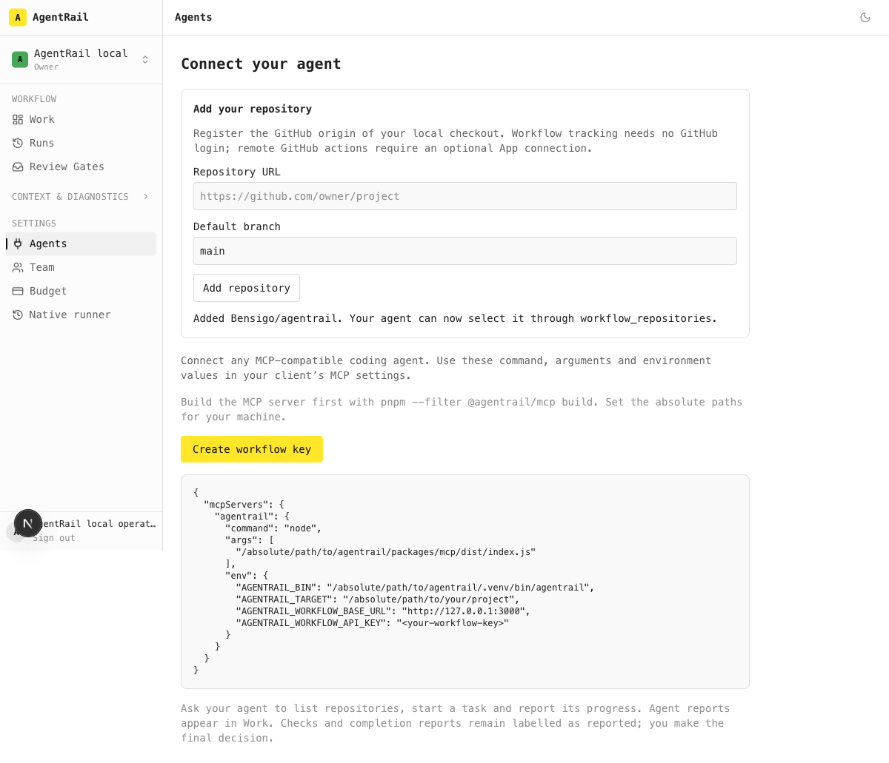
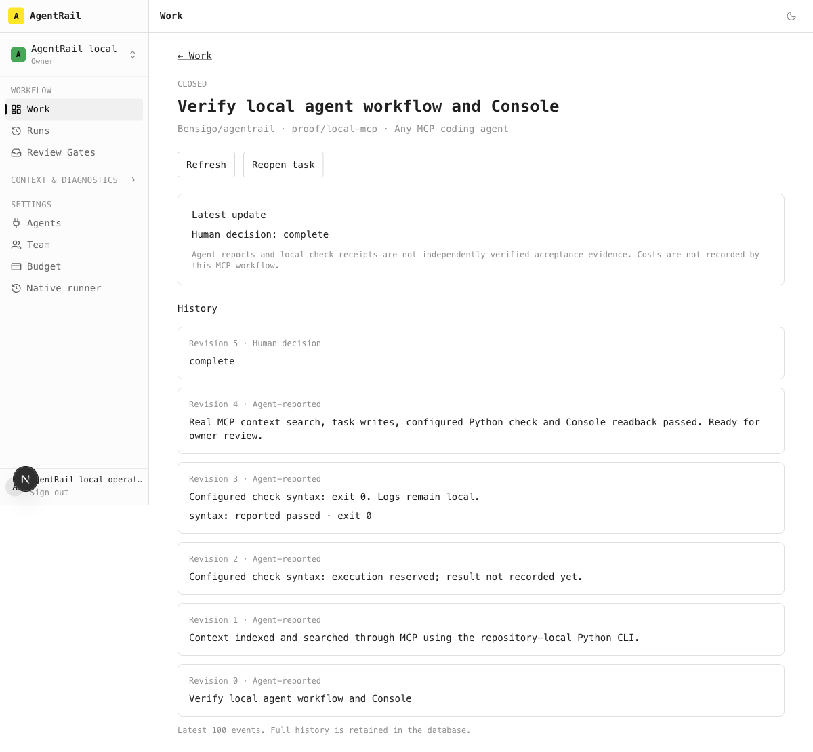

# Local separation verification — 2026-11-09

AgentRail and Jace are public Apache-2.0 projects with independent databases, artifact stores, Consoles and process lifecycles. Vercel is a subsequent hosting task; no production cutover is claimed.

## AgentRail

- `pnpm local:up` completed on macOS with Node 24, pnpm 9, Python and Docker. It installed the CLI into `.venv`, migrated PostgreSQL and ClickHouse, initialized the artifact bucket, and started the Console on loopback.
- A local owner signed in without GitHub OAuth. A replayed login code returned 401. Real PostgreSQL tests also covered concurrent exchange, persisted session expiry and expired/malformed codes (2 passed).
- In the browser, the owner registered a repository without a GitHub App. An owner-issued workflow credential then drove a real MCP SDK client: local CLI indexing, MCP context search, repository lookup, task start/update, a configured Python check, and `needs_review` handoff. The owner closed the task through the Console.
- Both local product sessions remained usable in the same browser. Shutdown preserved volumes. After restart, the same owner session read back the closed task, revision 5 and its complete retained event history.
- Python: 6,340 passed, 8 skipped, 85 deselected; Console: 3,458 passed; MCP: 6 passed. The inherited database run passed 1,885 tests in 149 retained files; its Jace-only cross-Console integration file was moved to Jace after its missing-import failure exposed the ownership mismatch. The copied Jace file was byte-checked before removal. Clean CI is the final all-files gate.
- A fresh-context review found startup blockers in CLI resolution, occupied-port handling and process shutdown. Those findings were fixed and the reviewer found no remaining blockers in those fixes.

- The final production Console build passed. A fresh PostgreSQL database and production Console passed the real MCP protocol harness: independent identities, deduplication, stale revisions, one-execution checks, concurrent holds, reservation credential custody, dirty-after receipts, post-check Git failure receipts, branch binding, tenancy, human decisions, restricted credentials and revocation.

## Boundaries

Agent names are reported labels. Real protocol interoperability is verified with independent SDK client identities; no claim is made that every third-party coding client was exercised. Check receipts remain agent-reported and do not become Jace acceptance proof. Remote GitHub actions and chat channels require their own credentials. No live deployment, external-device acceptance or production data migration is claimed.
