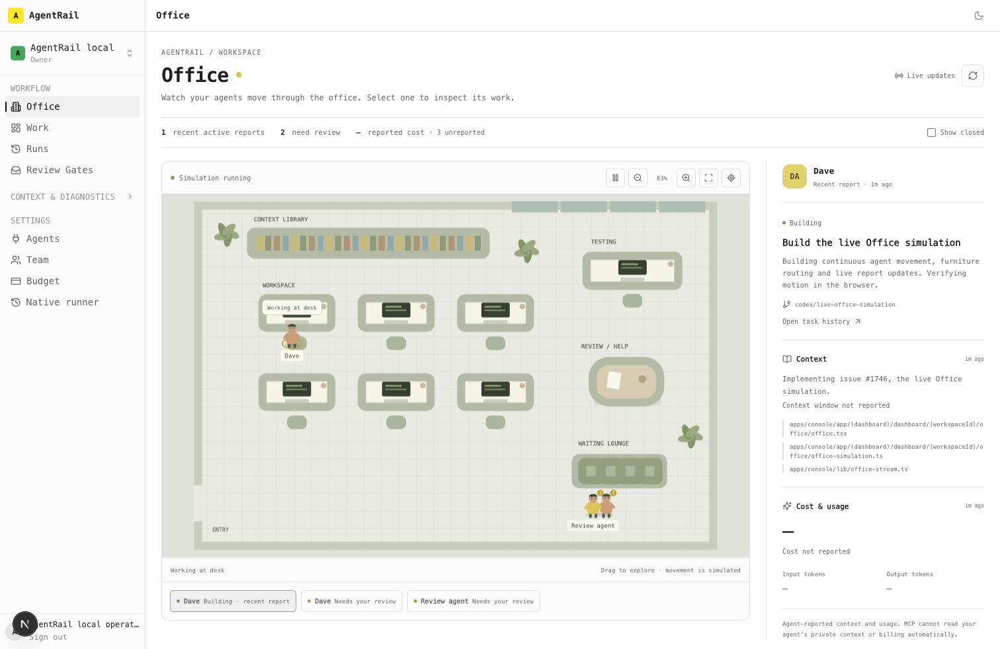

# AgentRail Office

Office is the daily Console home for MCP work sessions. The first implementation (#1743) displayed desk status; the owner asked for a live simulation in #1746. The current room has continuously moving people, furniture-aware routes, work stations and live reports.

## Simulation

- Each avatar is a task/work session identified by task ID. Two sessions may have the same display name; labels do not prove client identity.
- New sessions walk in from the entrance. Recent planning, implementation, testing and review reports send people to the context library, assigned desk, testing station and review table. Phase changes reroute from the current position rather than teleporting.
- People work at their station and, when shared context exists, take periodic virtual trips to the library. Waiting/blocked sessions stretch or wait near the lounge/help area. Closed sessions walk out. Furniture-aware grid routing keeps people out of desks and walls.
- Movement is a visualization, not a claim that a model physically changed tools or read a file. Stale reports (two minutes), missing reports and human-reopened work go idle. Idle movement never changes the reported phase, freshness, cost or context. An old needs-review report cannot become active because a human reopens the task.
- Select an avatar or accessible roster button to inspect task, branch, report, shared context and usage. Pan by dragging or with arrow keys; zoom, fit or center the selected session using the toolbar. Mobile selection focuses and scrolls to the inspector. Up to 100 sessions are shown, prioritizing open work.
- Pause freezes motion while keeping reports available. Reduced motion settles people directly at their stations and removes departures immediately. Hidden tabs stop rendering and disconnect their live stream.

## Live data and authority

- An authenticated SSE connection delivers changed snapshots from server reads every two seconds, with heartbeat timestamps between changes. Each connection ends within 50 seconds and reconnects. Disconnected clients fall back to five-second polling. Manual refresh remains available.
- Authority is checked before opening and again before each read. Every query uses the authorized workspace. Revoked credentials or membership end the stream. Connections have bounded buffering, sequential reads, abort/cancel cleanup and a deadline below the Vercel route's 60-second maximum.
- Responses are private/no-store. Superseded refreshes are aborted; older snapshots cannot overwrite newer state. The stream has no ability to write tasks or make human decisions.
- Context/usage are optional complete snapshots in `workflow_update`, retained in durable event history. Ordinary reports preserve telemetry and its own timestamp; the query resolves it beyond the 100-event history page.
- Usage is cumulative per task, never an increment. Each supplied usage object replaces its prior snapshot; `null` means unknown and zero means known zero. Context is a bounded shared summary/source list with counts when measured. MCP does not automatically reveal the host's private context or billing. Reports are not Jace acceptance evidence.

## Verification

The engine tests cover movement through collision-free routes, report-driven rerouting without teleporting, stale/reopened work, shared-context visits, departures, reduced-motion cleanup and a full 100-session cohort. Stream tests cover snapshots/heartbeats, revocation, backpressure, cancellation, abort and deadline cleanup. The production MCP protocol harness exercises real streaming updates, cross-workspace isolation and revocation against PostgreSQL.

Actual browser checks compare canvas frames over time: movement changes frames; Pause and reduced motion freeze them. A real MCP testing report updates the inspector and simulation without reload. The 390px phone view has no horizontal overflow and roster selection focuses the correct inspector. Test data never becomes real billing.

[Twenty-second recording of actual local movement](screenshots/office-live.mp4)

Independent review cleared the reduced-motion departure and routing-cost fixes. On the local review machine, initial routing for 100 sessions fell from about 531 ms to 28.46 ms; 100 unchanged reconcile/settle cycles took 15.44 ms total. These are local measurements, not a mobile-device performance guarantee. The room reuses one occupancy grid, preserves routes for telemetry-only reports, and rebuilds navigation only when furniture changes.
