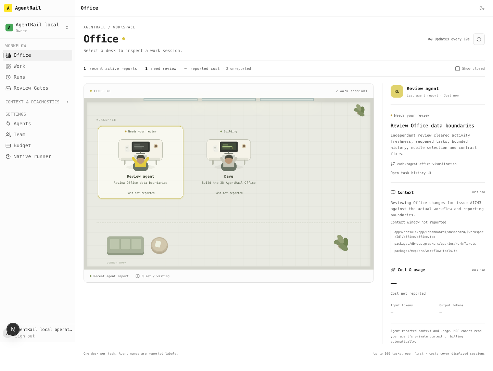
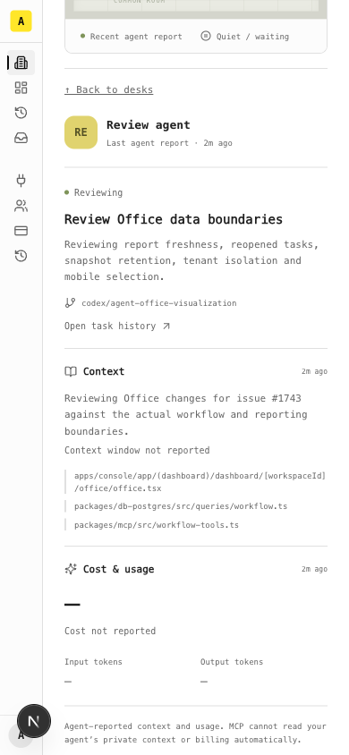
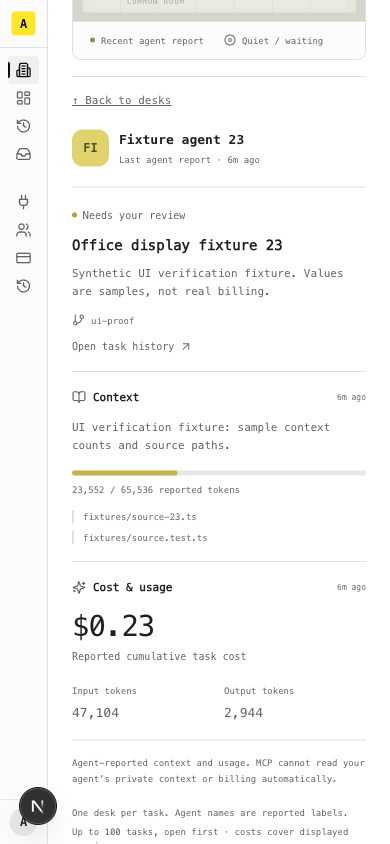

# AgentRail Office

Owner request: a clean 2D office with animated agents/desks, current tasks, context and cost. Tracked by #1743; this extends the independent AgentRail product after the repository split.

## Behaviour and boundaries

- Office is the daily Console home. Each desk is a task/work session identified by task ID; display labels do not prove client identity. Identical agent names do not merge distinct sessions.
- Select a desk for task, branch, last agent report, shared source context and usage. Mobile selection focuses and scrolls to the inspector; a return link goes back to desks. Up to 100 tasks are shown, prioritizing open work. The displayed-session cost subtotal shows the unknown count.
- Animate only when both current phase and the latest qualifying agent report are active, within two minutes by server-observed time. A human reopening a completed task cannot revive an old agent report. Poll every ten seconds; stale/closed/waiting tasks stay quiet. Reduced-motion preference disables animation.
- Context/usage are optional complete snapshots carried by `workflow_update`, retained in durable event history. Ordinary updates preserve previous telemetry and its own timestamp. The query resolves telemetry beyond the 100-event history page.
- Usage is cumulative per task, never an increment. Each supplied usage object replaces its previous snapshot; `null` means unknown, zero means known zero. Context is a bounded shared summary/source list with token/window counts when measured. MCP does not automatically reveal private host context or billing. Reports are not Jace acceptance evidence.
- Office reads require workspace authority. Responses are private/no-store; polling aborts superseded requests. Existing revision, retry and check-execution interlocks remain intact.

## Verification

- Complete Console suite: 3,462 passed. MCP suite: 6 passed. Type checking and production Console build passed.
- Real PostgreSQL integration: snapshots remain after 102 subsequent reports; replay does not duplicate usage; zero differs from unknown; same-name tasks remain distinct; tenant reads are isolated; telemetry cannot interrupt a reserved check. An older open task remains visible among 105 newer closed tasks. Human close/reopen retains the final reported phase.
- Real MCP clients reported the implementation and independent-review sessions, with actual source paths and unknown billing/context counts. The production protocol harness also exercises Office snapshot roundtrip and tenant isolation with explicitly synthetic telemetry.
- Browser: desktop desk selection and inspector, mobile 390px with 24 test desks, bounded floor scrolling, selected-inspector focus/scroll, and no horizontal overflow. The sample workspace's $0.23 is test data, not real billing.
- Independent review found four defects in activity, bounded visibility, mobile selection and contrast. All were fixed and cleared. Desk text contrast measured approximately 5.72:1 and 5.22:1 against the floor.

